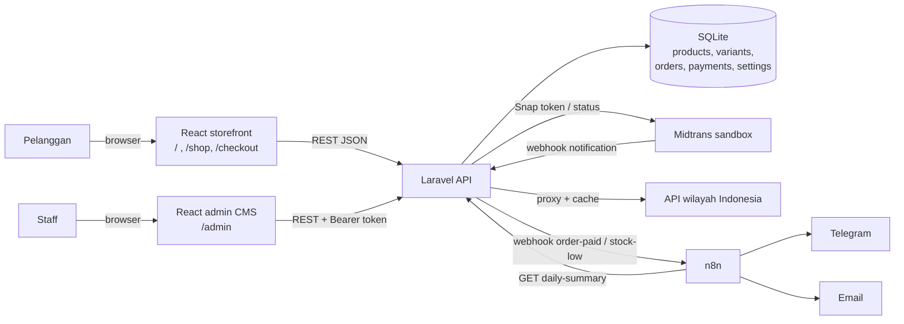

# Gentle Wear — Website + CMS (Backoffice ERP)

Toko online pakaian pria **Gentle Wear** beserta **CMS / backoffice ERP**-nya. Pelanggan belanja di website,
membayar lewat **Midtrans**, stok berkurang otomatis per varian, dan **n8n** mengirim notifikasi serta rekap penjualan.

| | Teknologi |
|---|---|
| Frontend (website + admin CMS) | **React 18** + Vite, React Router, GSAP |
| Backend (REST API) | **Laravel 13** (PHP 8.3+), Sanctum, SQLite |
| Payment gateway | **Midtrans Snap** (sandbox) + mode mock |
| Automation | **n8n** 2.8 (Telegram + email) |
| API eksternal | API wilayah Indonesia (provinsi & kota) |

---

## Arsitektur



Alur pembelian:

1. Frontend memuat produk & stok dari `GET /api/products` dan konten CMS dari `GET /api/content`.
2. Checkout → `POST /api/checkout`. **Harga, stok, dan ongkir dihitung ulang di server.** Laravel membuat order dan meminta token Snap ke Midtrans.
3. Frontend membuka popup Snap. Midtrans memanggil `POST /api/midtrans/notification` (signature diverifikasi).
4. Saat **paid**: stok varian dikurangi (tercatat di `stock_movements`), pembayaran dicatat di `payments`, lalu Laravel mengirim event ke n8n.
5. n8n mengirim Telegram ke admin + email ke pelanggan; stok di bawah minimum memicu alert; setiap malam 21:00 rekap penjualan.

## Pembagian modul

| Modul | Backend (Laravel) | Frontend (React) |
|---|---|---|
| **Katalog** | `Category`, `Product`, `ProductColor`, `CatalogController` | Landing, `/shop/:category`, editorial stage |
| **Inventory** | `ProductVariant` (stok per warna × ukuran), `StockMovement`, `VariantController` | Admin › Products & stock |
| **Penjualan / Order** | `Order`, `OrderItem`, `CheckoutService`, `OrderController` | Keranjang, `/checkout`, `/orders/:code`, Admin › Orders |
| **Pembayaran** | `MidtransService`, `PaymentService`, `Payment`, webhook | `services/payment.js` (Snap), lembar mock |
| **CMS konten** | `Setting`, `ContentController` | Admin › Website › Hero / Collection / Essentials / Story / Lookbook / Footer |
| **Auth & role** | Sanctum token, `User.role` (owner / admin / warehouse / finance) | Admin login |
| **Dashboard** | `DashboardController` | Admin › Dashboard (omzet 7 hari, best seller, stok menipis) |
| **Automation** | `N8nNotifier`, `N8nController`, middleware `VerifyN8nToken` | — (folder `n8n/`) |
| **API eksternal** | `RegionService` + `RegionController` (cache 1 hari) | Dropdown provinsi & kota di checkout |

## Pemenuhan requirement

| Requirement | Implementasi |
|---|---|
| API Connection | API internal Laravel (20+ endpoint) + API eksternal wilayah Indonesia |
| Payment Gateway | Midtrans Snap sandbox (token, webhook ber-signature, sinkron status) + mock |
| Automation n8n | 3 workflow: order paid, low stock, daily recap (`n8n/workflows/`) |
| Frontend framework modern | React + Vite |
| Backend bukan Firebase | Laravel + SQLite |
| Website + CMS | Storefront publik + admin `/admin` (produk, stok, order, konten) |

---

## Struktur folder

```
ERP/
├── frontend/   React: storefront + admin CMS (src/admin)
├── backend/    Laravel API (app/Services, app/Http/Controllers/{Api,Admin}, database/)
├── n8n/        n8n project: workflows/*.json, start.mjs, README
└── README.md
```

## Instalasi & menjalankan

Prasyarat: **Node.js 22**, **PHP 8.3+** (ekstensi `pdo_sqlite`, `sqlite3`, `intl`, `zip`, `fileinfo`, `curl`, `openssl`) dan **Composer**.

### 1. Backend (Laravel) — http://localhost:8000

```bash
cd backend
composer install
cp .env.example .env
php artisan key:generate
php artisan migrate --seed
php artisan serve
```

Seeder membuat 5 kategori, 20 produk, 150 varian (dengan stok awal), konten CMS, dan akun admin.

### 2. Frontend (React) — http://localhost:5173

```bash
cd frontend
npm install
cp .env.example .env.local     # isi VITE_API_URL=http://localhost:8000/api
npm run dev
```

Tanpa `VITE_API_URL`, website tetap jalan dengan data demo bawaan (tanpa admin).

### 3. n8n — http://localhost:5678

```bash
cd n8n
npm install
cp .env.example .env           # GW_N8N_TOKEN = N8N_API_TOKEN dari backend/.env
npm run import
npm run activate
npm start
```

Lengkapnya (Telegram bot / email Brevo): **[n8n/README.md](n8n/README.md)**.

### Akun admin demo

Buka **http://localhost:5173/admin** — `admin@gentlewear.test` / `gentlewear123`
(ubah lewat `ADMIN_NAME` / `ADMIN_EMAIL` / `ADMIN_PASSWORD` di `backend/.env`, lalu
`php artisan db:seed --class=AdminUserSeeder`). Password juga bisa diganti dari Admin › Settings › Account.

Menu backoffice:

| Grup | Halaman |
|---|---|
| Overview | KPI + sparkline, grafik omzet vs periode sebelumnya (7H / 30H / 90H / 12B), omzet per kategori, order terbaru (filter status, sort), stok menipis |
| Store | Products (Store Management + panel Product Detail), Inventory (stok per varian, low/out, riwayat), Add product |
| Sales | Orders, Payments (riwayat Midtrans), Customers |
| Website (CMS) | Site & SEO (nama toko, judul tab, deskripsi, favicon, logo), Navbar (ganti nama / sembunyikan / urutkan menu), Hero (teks, poster, 4 pasang video), Collection, Essentials, Story, Lookbook, Footer — teks, foto/video (upload atau link), pilihan & urutan produk, link sosial |
| Settings | Account (profil + ganti password) |

---

## Midtrans sandbox

Tanpa key, Laravel otomatis memakai **mode mock** (lembar pembayaran simulasi: paid / pending / failed).
Untuk memakai Midtrans sungguhan (sandbox, uang tidak benar-benar berpindah):

1. Daftar gratis di **https://dashboard.sandbox.midtrans.com** (atau midtrans.com → Sign up, lalu pilih environment *Sandbox*).
2. **Settings → Access Keys** → salin **Server Key** (`SB-Mid-server-…`) dan **Client Key** (`SB-Mid-client-…`).
3. Isi di `backend/.env`, lalu restart `php artisan serve`:
   ```
   MIDTRANS_SERVER_KEY=SB-Mid-server-xxxx
   MIDTRANS_CLIENT_KEY=SB-Mid-client-xxxx
   MIDTRANS_IS_PRODUCTION=false
   ```
   Frontend tidak perlu diubah — client key dikirim oleh backend saat checkout. *Server key jangan pernah ditaruh di frontend.*
4. Checkout di website → popup Snap muncul. Cara "membayar" di sandbox:
   - **Virtual account / QRIS / GoPay:** salin nomor VA atau QR, lalu bayar di **https://simulator.sandbox.midtrans.com**.
   - **Kartu kredit uji:** `4811 1111 1111 1114`, CVV `123`, kedaluwarsa bulan/tahun di masa depan, OTP `112233`.
5. **Webhook (opsional di laptop):** Midtrans tidak bisa memanggil `localhost`. Untuk uji webhook, jalankan
   `ngrok http 8000`, lalu di **Settings → Configuration → Payment Notification URL** isi
   `https://<id>.ngrok-free.app/api/midtrans/notification`.
   Tanpa ngrok tetap aman: setelah popup ditutup, frontend memanggil `GET /api/orders/{code}?sync=1` dan
   Laravel menanyakan status langsung ke Midtrans. Di halaman order juga ada tombol **Refresh status**.

---

## API

| Method | Endpoint | Keterangan |
|---|---|---|
| GET | `/api/products` | Kategori + produk + warna + stok per varian |
| GET | `/api/content` | Konten CMS landing page |
| GET | `/api/regions/provinces` | Provinsi (API eksternal, cache) |
| GET | `/api/regions/provinces/{id}/cities` | Kota/kabupaten |
| POST | `/api/checkout` | Buat order → `{ order, payment: { mode, token, client_key } }` |
| GET | `/api/orders/{code}` | Status order (`?sync=1` cek ke Midtrans) |
| POST | `/api/orders/{code}/mock-pay` | Simulasi pembayaran (hanya mode mock) |
| POST | `/api/midtrans/notification` | Webhook Midtrans (signature SHA-512) |
| GET | `/api/n8n/daily-summary` | Data rekap untuk n8n (header `X-N8N-Token`) |
| POST | `/api/admin/login` · `/logout` · GET `/me` | Auth admin (Sanctum bearer token) |
| GET | `/api/admin/dashboard?range=7d\|30d\|90d\|12m` | KPI, grafik omzet vs periode sebelumnya, kategori, order terbaru |
| GET | `/api/admin/inventory` · `/payments` · `/customers` | Stok semua varian, riwayat pembayaran, daftar pelanggan |
| PUT | `/api/admin/me/password` | Ganti password admin |
| POST | `/api/admin/media` | Upload foto / video CMS (jpg, png, webp, gif, ico, mp4, webm; maks 60 MB) → `public/uploads/cms` |
| GET/POST/PUT/DELETE | `/api/admin/products[/{sku}]` | CRUD produk (POST membuat varian warna × ukuran) |
| PUT | `/api/admin/variants/{id}` · GET `/movements` | Atur stok & minimum, riwayat stok |
| GET/PUT | `/api/admin/orders[/{code}]` | Daftar order, packed → shipped (resi) → completed |
| GET/PUT | `/api/admin/content` | Ubah konten landing page (per section) |

---

## Catatan frontend

- **Hero**: 8 klip video dengan state machine tanpa kedip (`src/hooks/useScenePlayer.js`). Lokasi video diatur `VITE_MEDIA_BASE`
  (`/videos/` = file lokal di `public/videos`; klip itu demo milik LTX — ganti dengan video sendiri untuk versi final).
- **Animasi**: GSAP ScrollTrigger lewat atribut `data-reveal`, `data-reveal-words`, `data-parallax` (`src/animations/scrollAnimations.js`); otomatis mati untuk *reduce motion*.
- **Navbar**: [PillNav dari React Bits](https://reactbits.dev/components/pill-nav), hilang saat scroll ke bawah.
- **Detail produk**: editorial stage (tilt 3D, flip, colour reveal, hotspot) di `src/components/shop/EditorialStage.jsx`.
- **Varian warna**: foto per warna dibuat dengan `frontend/scripts/recolor_variants.py` (mask GrabCut + recolor Lab).
- **Data katalog awal**: `frontend/src/config/catalog.js` → `node scripts/export-catalog.mjs` → `backend/database/seeders/data/catalog.json`.
